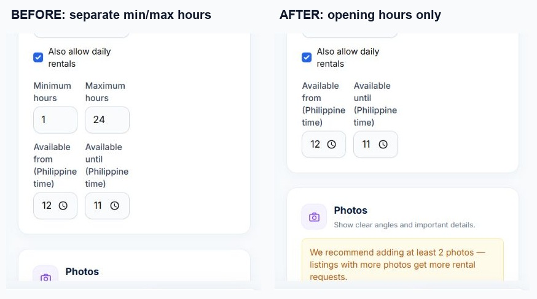

# Phase 1 — implemented before/after

Implemented locally on November 1, 2026. This covers the agreed rental rules, including the UI controls required to use them. It does not implement the remaining phases' category, map, notification, dashboard, payment, or admin changes.

## Behavior comparison

| Area | Before | After |
| --- | --- | --- |
| Earliest new request | Tomorrow | Today, with a future start time in Philippine time and a valid owner opening window |
| Owner duration settings | Maximum days plus separate min/max hours | One maximum-days cap; min/max-hour inputs and restrictions removed |
| Maximum days | Checked by backend, but not enforced by the calendar selection | Calendar and request-date bounds enforce the cap; backend revalidates it |
| Hourly duration | Could be restricted by the separate old hour limits | Whole-hour duration capped at maximum days × 24, at the existing hourly rate |
| Daily requests | Date-only period | Selected start and return times recorded in UTC and displayed in Philippine time; inclusive calendar dates still determine daily billing |
| Renter calendar | Whole-date display, with some backend rules allowing adjacent hourly commitments | Date-level availability matches backend blocking. A different time on the same occupied date does not bypass the commitment |
| Overnight boundary | Exact-hour checks existed separately from the calendar | Midnight end is excluded from the next occupied date; hourly periods crossing closed opening hours are rejected |
| Item still with a renter | Owner could toggle the availability switch without a readiness check | Reopening is rejected while the item is in use, overdue, or returned but not inspected |
| Return and inspection | Returned/completed status released reservation dates without a separate reopening requirement | A persistent reopening requirement remains until the owner explicitly reopens after inspection |
| Same-day reuse | New requests were restricted to tomorrow | After return, inspection, and reopening, another future start later today can be requested |
| Owner schedule | Reservation date summaries | Exact booking intervals, opening hours, and remaining free periods today |
| Cart and approval | Existing availability checks | Also recheck readiness/reopening; a stale cart or pending request cannot bypass the new rule |
| Existing history | Existing saved prices, periods, agreements, and payments | Preserved. Legacy date-only agreements retain their old representation; new requests receive exact times |

Maximum days is a ceiling, not a minimum charge. Example: with a one-day maximum and a ₱50 hourly rate, an eligible two-hour request still costs ₱100 rental fee. A full 24-hour hourly rental can span two dates; its exact times are validated in the request form. Daily bookings count both selected dates.

Daily rentals may span nights while the item remains with the renter; their pickup/return endpoints must fit the owner's opening hours. Hourly overnight rentals require the owner's full-day opening window. Existing confirmed future commitments remain protected after reopening.

## Screenshots

Comparison crops below are taken from the real owner form. No account or listing was created or submitted to obtain these screenshots.

- [Original owner view](phase-1-evidence/owner-form-before.jpg)
- [Updated owner view](phase-1-evidence/owner-form-after.jpg)
- [Updated renter request](phase-1-evidence/renter-request-after.jpg)

Browser verification against MySQL showed the request form's earliest date as `2026-11-01`, start/return-time controls, and a latest daily end date of `2026-11-07` for a seven-day maximum starting November 1. No live rental request or payment was submitted. Existing identity approval requirements remain enforced.

## Verification

- Full PHP run: 1,015 tests; 1,006 passed initially, with nine reservation/status assertions requiring updates or fixes for the new reopening and Philippine-time rules.
- Final targeted rerun: all 71 tests passed, covering all nine earlier failures plus three additional Phase 1 regression scenarios. Across both runs, all 1,018 unique tests have passing results; no unresolved failures remain.
- Final Phase 1 rerun: all 12 scenarios passed with 42 assertions, including a calendar refresh after reopening and owner-visible unbooked periods that do not bypass readiness checks.
- Separate affected-flow run: 128 tests passed before the final reservation/status fixes.
- All 42 JavaScript tests passed, including maximum calendar range, hourly date boundary, and paused-request selection tests.
- Production Vite build passed. PHP formatting and Git whitespace checks passed.
- The local MySQL migration completed and no migrations remain pending.

The PHP tests use isolated in-memory SQLite, not live user transactions. MySQL-backed browser checks cover the real form rendering and constraints. Evidence: `storage/logs/phase-one-suite.xml`, `phase-one-final-retest.xml`, and `phase-one-verification-summary.json`.

## Local database change

`2026_11_01_000001_add_listing_reopening_control` adds `listings.reopen_required`. Existing active, overdue, returned, and handed-over paid rentals require return/inspection and reopening before accepting new requests. Existing completed history is not automatically closed.

A pre-migration database backup is retained in private storage at `storage/app/private/backups/tala-before-phase-one.sql`.
