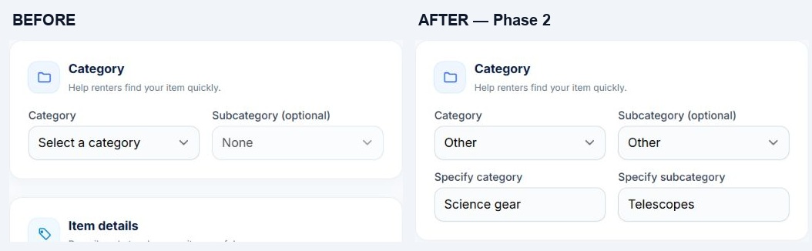

# Phase 2 — owner listing creation and editing

Implemented locally on November 1, 2026, at `/owner/listings/create` and `/owner/listings/{listing}/edit`.

| Area | Before | After |
| --- | --- | --- |
| Category | Existing options only | Other reveals a required category name; saved as a reusable category |
| Subcategory | Existing options only | Other reveals a required name under the selected category; unrelated parent/child combinations are rejected |
| Edit custom categories | No custom input flow | Saved custom names appear as selected categories when editing; matching names reuse existing records |
| Map pin | Updated coordinates only | Pin click/drag looks up and fills Location; address remains editable, and stale lookups cannot overwrite a newer pin or an edit made during lookup |
| Lookup failure | Manual location entry | Pin remains usable, with manual entry and retry guidance; denied device location offers the map fallback |
| Photos | A later selection replaced earlier pending uploads | Each batch appends; all existing and pending photos remain visible and individually removable, with a total counter |
| Photo limits | Per-file validation | Up to 20 total photos at 4 MB each, with invalid/excess batches preserving earlier selections and publishing disabled during upload |
| Original price | Saved but ignored by the suggestion | Updates the daily-rate suggestion live; owner applies it explicitly |
| Availability | Phase 1 controls | Maximum days, opening hours, date window, and inspection/reopening requirement remain enforced when editing |

## Pricing calculation

With an original price, the suggestion uses that price multiplied by the median daily-rate/original-price ratio of published comparable listings that have both prices. The edited listing is excluded. Without sufficient original-price comparison data, the form clearly labels a starting estimate of **1% of original price per day**. This is an adjustable starting point, not a guaranteed market value. Without an original price, existing average daily rates remain the reference. Suggestions never overwrite the owner's rate unless the owner clicks **Use suggested daily rate**.

## Address provider

The configurable `LISTING_GEOCODER_URL` defaults to Photon's public reverse-geocoding endpoint. Pin coordinates are sent to that provider; the form discloses this and credits OpenStreetMap. Requests have a timeout, one-day coordinate cache, a shared one-request-per-second limit, and a per-user limit of 30 attempts per minute. The public demo has no availability guarantee; configure a suitable Photon-compatible service for heavier traffic, or leave the environment variable blank to use manual addresses.

Provider references: [Photon project and usage](https://github.com/komoot/photon), [reverse-geocoding API](https://github.com/komoot/photon/blob/master/docs/api-v1.md).

No database migration is needed for Phase 2: custom category names use the existing category hierarchy and foreign keys. Existing listing data is retained.

## Actual browser evidence

These are local application screenshots. The before image was captured before changing the Phase 2 form. The after images use the existing demo owner's unsubmitted form and two repository sample images; no listing was published and no identity status was changed for the screenshots. The map test used a public point at Liwasang Bonifacio, Manila, rather than device geolocation.

- [Full before view](phase-2-evidence/before.jpg)
- [Custom category and subcategory](phase-2-evidence/after-category.jpg)
- [Original-price suggestion and apply button](phase-2-evidence/after-pricing.jpg)
- [Autofilled address and two cumulative photos](phase-2-evidence/after-photos-map.jpg)

## Verification

- Complete PHP suite: **1,029 tests, 7,717 assertions passed**, using isolated in-memory SQLite. Includes login/authentication, listing creation/editing, rental, payment, identity and Phase 1 regressions.
- Affected listing/availability tests: **47 tests, 231 assertions passed** before the full run.
- JavaScript suite: **47 tests passed**, including five new address/race/fallback checks.
- Production Vite build passed; changed PHP files formatted with Pint; `git diff --check` passed.
- Browser: Other fields appeared, original-price suggestion updated, a public Manila pin filled the address, two separate upload batches remained visible together, and no browser console warnings/errors were recorded.

PHP coverage includes custom-name persistence and reuse, parent/child validation, whitespace-required fields, cumulative upload saving, invalid/excess batch preservation, original-price reactivity and explicit apply, inspection-flag preservation, provider cache/throttle/failure, and lookup authorization/coordinate validation. JavaScript checks cover stale pin responses, manual edits during lookup, failures/retry, and denied or late device location.

Payment, renter product-detail changes, request-modal status, notifications, navigation and admin changes remain in later phases.
