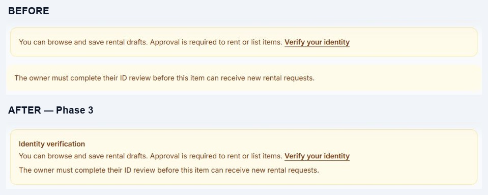

# Phase 3 — product details, maps, and availability waitlist

Implemented locally on November 1, 2026.

| Area | Before | After |
| --- | --- | --- |
| Product identity notices | Separate renter and owner warning boxes | One Identity verification panel preserves both applicable explanations and the verification link |
| Rental request identity notices | Renter notice at top and separate owner notice near submit | One combined panel inside the modal or standalone request form; ID checks still enforce eligibility |
| Item information | Description, condition, brand/model, location, fulfillment, maximum days, rates and rules | Also shows purchase year and owner's estimated original price when provided |
| Availability information | Date calendar and duration cap | Also displays owner pickup/return hours in Philippine time and explains daily/hourly billing |
| Public calendar | Phase 1 date selection and limits | Preserved: shows date-level holds/reservations, carries selected dates into the request, and keeps exact booking schedules private |
| Location success | No success popup; failure callback emitted the success-named event | Successful location explicitly clears stale errors and displays a dismissible success popup; errors and invalid coordinates never report success |
| Owner location request | A late device failure could add an error after a newer manual pin | Late failure is ignored when a newer pin has already been selected |
| Map item selection | Photo/name/rate preview and direct pin navigation | Preserved and verified, including keyboard selection, hourly prices, and escaped item names |
| Cart waitlist | Button appeared for all usable items, including free dates | Button appears only for valid, eligible saved periods with a real booking conflict; refreshes while the cart is visible |
| Request-form waitlist | Button always visible | Same eligibility rules apply to the currently selected period |
| Stale waitlist actions | Backend rejected free periods | Still revalidated when clicked; a stale button cannot join after a conflict is released |
| Cart schedule | Daily drafts could show a blank day count beside exact times | Displays the inclusive day count with the selected start/return times |

The public time display describes the owner's handover window, not other renters' exact schedules or free-hour gaps. The Phase 1 date-only calendar and owner inspection/reopening requirement remain in effect. Rates, fee formulas, payments and approval agreements are unchanged by this phase.

## Before and after

- [Full product before](phase-3-evidence/product-before.jpg)
- [Full product after](phase-3-evidence/product-after.jpg)
- [Renter availability and item details](phase-3-evidence/availability-after.jpg)
- [Combined notice in the request modal](phase-3-evidence/request-after.jpg)
- [Cart after saving selected dates](phase-3-evidence/cart-after.jpg)
- [Keyboard-focused map preview](phase-3-evidence/map-preview.jpg)

Screenshots are from the actual local application. Existing demo accounts were used without changing verification status. A temporary draft was saved to an initially empty demo cart, verified, and removed; no rental request, booking, payment or notification was submitted. Device location was not requested. Location success, denial, invalid responses, and stale callback behavior were checked using the actual JavaScript components with mocked browser boundaries.

## Verification

- Affected PHP regressions: **103 tests, 510 assertions passed** before the final full run.
- JavaScript suite: **50 tests passed**, including location success/error and late callback checks, plus existing calendar and map-pin selection checks.
- Production Vite build passed. Changed PHP files formatted with Pint.
- Browser: demo renter login succeeded; selected November 4–5 dates reached the request modal, quote settled at two daily charges, draft saved with exact times, available-period waitlist controls were absent, and the temporary draft was removed. Focusing the Karaoke Machine map pin showed its preview; Enter opened the matching `/listings/44` detail page.
- Complete PHP regression suite: **1,037 tests, 7,763 assertions passed**, using isolated in-memory SQLite.

New PHP scenarios cover combined notices for unverified/verified/guest participants, optional item information and owner hours, available-period rejection, conflicting-period waitlisting and release, invalid/paused/unverified eligibility, saved dates versus unsaved cart edits, and matching request-form behavior.

No database migration is required. Phase 4 owner approval modal/agreement status and later payment/dashboard/navigation/admin work remain separate.
