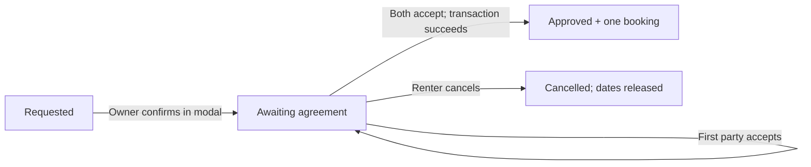
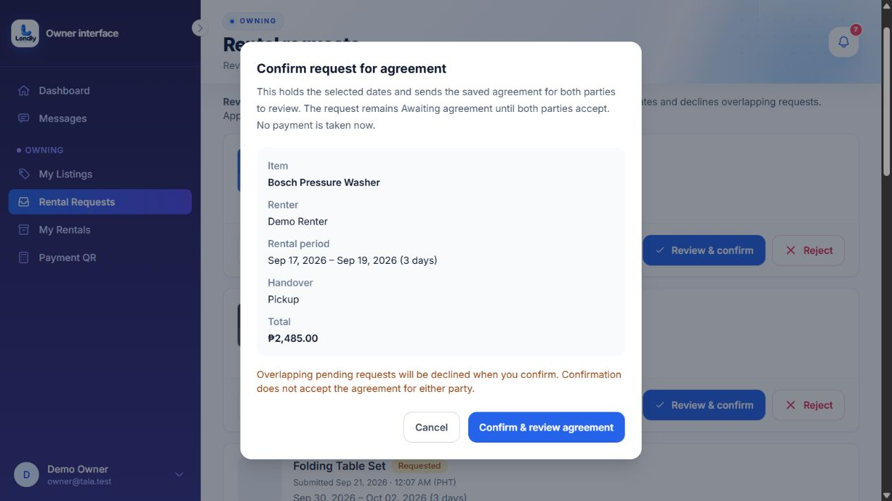

# Phase 4 — owner confirmation and mutual agreement

Implemented locally on November 1, 2026.

| Area | Before | After |
| --- | --- | --- |
| Owner confirmation | Inline confirmation panel inside the request card | Native modal with item, renter, exact period when recorded, handover and total; Cancel, Escape and backdrop dismissal |
| Owner action | Set status to Approved before agreement acceptance | Set status to Awaiting agreement; neither acceptance timestamp is filled automatically |
| First acceptance | Request already displayed Approved | Still Awaiting agreement; no booking or payment step is created |
| Second acceptance | Created the booking | Atomically marks the request Approved and creates one booking |
| Booking or notification failure | Booking transaction rolled back | Also rolls back final Approved status and the second acceptance |
| Agreement-ready notification | Request approved | Rental agreement ready, with a link for each participant to review and accept |
| Date holds | Approved status held dates before both acceptances | Awaiting agreement also holds dates; confirmation still declines overlapping pending requests |
| Request lists | Pending/Approved/Rejected/Cancelled | Adds Awaiting agreement filter and badges; review links work for both awaiting and approved requests |
| Cancellation and account closure | Existing unfinalized request safeguards | Awaiting-agreement requests remain cancellable by the renter without a booking fee and block account deletion while outstanding |
| Existing records | Approved included unfinalized agreements | Migration relabels only approved requests without bookings; existing bookings and saved agreements are preserved |
| Hourly boundary | Owner confirmation also checked inclusive day count | A valid 24-hour hourly request can span two calendar dates under a one-day cap; exact duration is validated by the shared rental-period rules |

Confirmation sends the agreement for review. Each participant must explicitly accept from their own account. Merely opening the modal, confirming the request, or checking a box without submitting acceptance does not finalize the booking. The saved agreement, acceptance timestamps, final status, booking and confirmation notifications are checked or written inside the existing transaction and lock flow.

The date hold begins at owner confirmation, as in the previous flow. Existing ID, availability, duration, fulfillment and conflict checks still run on confirmation and acceptance. Cancellation before booking creation releases the hold. Approved counts now naturally exclude requests awaiting agreement.

## Actual owner modal

This is an existing demo request opened only to inspect the UI. No confirmation, agreement acceptance, payment, request rejection or verification change was submitted through the browser. Escape dismissal was verified. The lifecycle and acceptance orders were tested with isolated synthetic records.

## Local migration

Applied `2026_11_01_000002_mark_unfinalized_requests_as_awaiting_agreement` to the active local MySQL database after creating a private backup of the affected rows under `storage/app/private/backups/phase-4`.

The local database had **0 approved requests without bookings**, so no existing request needed relabeling. Its **34 existing bookings** were retained. The migration also supports databases that do have unfinalized legacy requests; automated coverage verifies that only those requests are relabeled and saved terms/acceptance timestamps remain unchanged.

Existing booked history is retained even if an older record lacks the timestamps expected for a new booking. This phase does not reconstruct historical acceptance or change saved contract wording. Newly generated agreements describe the Awaiting agreement → Approved lifecycle.

## Verification

- New Phase 4 scenarios: **8 tests, 69 assertions passed**, including both acceptance orders, checkbox validation, authorization, modal cancellation, hold release, transaction rollback, migration preservation and the 24-hour boundary.
- Related request/agreement/notification/history regressions passed after updating expectations for the new intermediate status.
- JavaScript suite: **50 tests passed**; production Vite build passed.
- Complete PHP run covered **1,045 scenarios**. Four tests still expected the old immediate-approved state; their expectations and the controlled interleaving trigger were updated for Awaiting agreement. The affected agreement/queue/concurrency retest then passed **63 tests, 656 assertions**. Combining the full run with these corrected retests verifies all **1,045 unique scenarios**, with no remaining failures.
- PHP files formatted with Pint; `git diff --check` passed. The browser's new Awaiting agreement filter loaded correctly with no console warnings/errors recorded.

Payment collection, processing/cancellation fee changes and deposit confirmation remain in Phase 5. Dashboard visuals, navigation and broader notification changes remain in their later phase.
