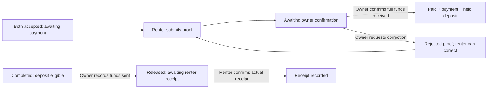
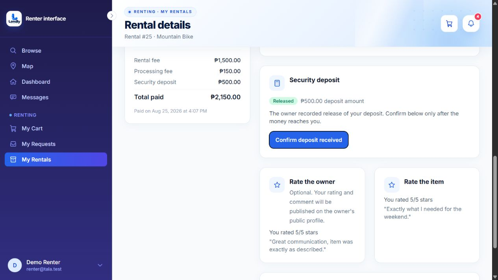

# Phase 5 — payments, fees, and deposit confirmation

Implemented locally on November 1, 2026.

| Area | Before | After |
| --- | --- | --- |
| Fee labels | Platform fee / platform fee (processing) | Processing fee across quotes, cart, agreement display, receipts and summaries |
| Initial breakdown | Existing rental charge + fee + refundable deposit | Same saved amounts and formula; explicitly explains that processing is charged once and cancellation fees are excluded from the initial total |
| Cancellation fee | Existing policy preview and cancellation workflow | Retained and verified: preview does not charge; pending cancellation does not write the fee to the booking; approved cancellation records the applicable rental-only fee |
| Pending payment | Rental card still said Pay now after proof submission | Awaiting payment confirmation; detail view suppresses payment instructions/form while proof is pending, and dashboard pay reminders exclude those bookings |
| Owner-wallet receipt | Owner acknowledgement followed by mandatory admin review | Owner confirmation atomically records payment, held deposit, verified proof, paid status and payment notifications; no admin approval step |
| Incorrect owner-wallet proof | Admin rejection | Owner requests correction with a required reason; renter can resubmit within the existing payment window |
| Admin involvement in owner payments | Admin was notified and could approve/reject | Owner receives the proof notification; admin verification/rejection is denied for pending owner-wallet proofs |
| New agreement payment destination | Owner wallet, with automatic platform fallback | New agreements require the owner's configured QR; no silent switch to platform collection if QR is unavailable |
| Deposit release | Owner confirmation dialog and Released status | Clear confirmation that funds were actually sent; records release timestamp, keeps renter receipt separate, and blocks release during unresolved disputes/claims |
| Deposit receipt | No renter acknowledgement | Renter can explicitly confirm actual receipt of the refundable balance; timestamp and owner notification record that acknowledgement |
| Outstanding new release | Released status could allow account deletion immediately | A positive released balance with a new release timestamp remains outstanding until the renter acknowledges receipt |

## Calculation and status examples

For a ₱300 rental, 10% processing fee and ₱500 refundable deposit, the initial total remains **₱830**. A 20% cancellation fee, when applicable, is **₱60 from the rental charge**, not 20% of the processing fee or deposit. Previewing or requesting cancellation does not add ₱60 to the initial payment. The saved cancellation policy determines whether cancellation requires review and whether a fee applies. Existing agreements, payment amounts and refund rules are preserved.

The application records manual transfers and acknowledgements; these controls do not move money. Owner confirmation requires an active matching payment recipient, explicit funds-received confirmation, the full saved amount, usable private proof, accepted agreement and an unused payment reference. Repeated confirmation does not create another payment, deposit or notification. A failure during recording rolls the transaction back.

## Existing platform-payment history

Older agreements and already frozen platform payment destinations retain their original collection workflow and audit records. They are not silently reassigned to an owner who may never have received those funds. Legacy platform review remains available only for those old platform payments. The normal flow for newly generated agreements is owner QR → renter proof → owner confirmation, without admin payment intervention. Existing owner-wallet pending acknowledgements can be finalized by the actual owner recipient under the new flow.

New owner-generated agreements store `payment_review: owner` so this distinction survives later configuration changes. Old saved contract wording is not rewritten. If an owner has not enabled a QR for a new agreement, the UI directs the parties to configure it before paying.

## Local migration and history

Applied the additive `2026_11_01_000003_add_deposit_confirmation_timestamps` migration to local MySQL after saving a private deposit backup under `storage/app/private/backups/phase-5`.

The database contained **34 bookings, 30 payment records, 0 submitted proofs and 30 deposits** before migration. The migration adds nullable `released_at` and `received_at` columns and does not backdate acknowledgements or alter historical amounts/statuses.

Post-migration verification found the same record counts and **0 recorded renter receipt confirmations**. Browser inspection did not assert any payment receipt or deposit transfer on those records.

## Evidence and verification

This screenshot is from an existing completed demo booking. Only the receipt and confirmation control were viewed; no payment or deposit acknowledgement was submitted. Demo renter login and page access worked, with no console warnings/errors recorded. The new owner-wallet pending/confirmed/corrected-proof states were exercised with isolated test records rather than asserting receipt of funds on existing bookings.

- New payment/deposit and legacy-platform checks: **20 tests, 203 assertions passed** before the full run.
- JavaScript suite: **50 tests passed**; production Vite build passed.
- The full PHP run covered **1,052 scenarios**. Twenty existing checks required updates for owner-only confirmation, explicit legacy-platform reservation fixtures, or dispute settlement and receipt before account deletion. The affected retest passed **114 tests, 823 assertions**. Combining the full run with those corrected retests verifies all **1,052 unique scenarios**, with no remaining failures.
- PHP files formatted with Pint; `git diff --check` passed.

New automated scenarios cover no platform fallback for new agreements, pending-payment labels, owner-only finalization, admin restrictions, duplicate confirmation, corrected proof, transactional rollback, separate deposit release/receipt, recipient authorization, and cancellation fee timing. Existing owner-wallet tests continue to check private proofs, frozen recipient settings, references, invalid actors, missing proof, incorrect amount and stale states.

Dashboard visuals, role switching, broad notification changes, required-field markers, and admin list/search improvements remain in Phase 6.
